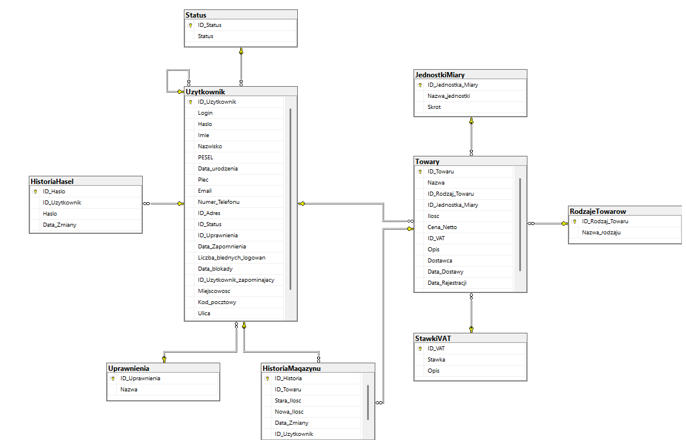

# Warehouse Management System – Users & Permissions Module 📦

## 📖 About The Project

A desktop application ("thick client" / WinForms) serving as a comprehensive administrative module for a warehouse management system. The project focuses on secure user lifecycle management, strict Role-Based Access Control (RBAC), and advanced data validation. 

The application was designed with top security standards and compliance with the EU General Data Protection Regulation (GDPR) in mind.

## ✨ Key Features

### 🔐 Login & Security Module (Authorization)
* **Role-Based Access Control (RBAC):** Automatic routing to appropriate dashboards (Admin Panel vs. User Panel) based on assigned roles (e.g., Admin, Warehouse Worker, Manager).
* **Password Policy:** Enforcement of strong passwords (8-15 characters, upper/lowercase letters, digits, special characters) verified via Regular Expressions (Regex).
* **Secure Access Recovery:** Automated generation of secure, unique passwords sent to the user, forcing a password change upon the first login.
* **Login History:** Logging every login attempt (successful and failed) with IP address and timestamp. Brute Force attack prevention (account lock after 3 failed attempts).

### 👥 User Management Module (CRUD)
* **Add & Edit:** Extensive data entry forms with SQL transaction support (protecting against partial saves).
* **Advanced Data Validation:** 
  * Checksum verification for the Polish National ID number (PESEL) using the weight algorithm.
  * Matching the PESEL number with the selected birth date and gender.
  * Database uniqueness validation (e.g., Login, PESEL, Email, Phone).
  * Regex control for email formats, postal codes, and letter-only constraints for names.

### 🛑 GDPR Compliance (Right to be Forgotten)
* **Data Anonymization:** A mechanism for "forgetting" a dismissed employee. Instead of physically deleting the record (which would break relational links in the warehouse history), sensitive data (First Name, Last Name) are overwritten with a string of 'xxxxx'.
* **"Fake" PESEL Generator:** The system automatically generates a random but mathematically correct PESEL number, so the anonymized record still passes structural validations in the database while preventing the identification of the real person.
* **Isolated View:** A separate admin panel for viewing and filtering only anonymized accounts along with their "forgotten" date.

### 🛡️ Permissions Module
* Assigning, editing, and reviewing system roles.
* Dynamic filtering of the employee database (DataGrid) based on assigned job roles.

## 🗄️ Database Architecture

The system uses a relational **Microsoft SQL Server** database. Referential integrity constraints (Foreign Keys, Check Constraints) and appropriate data typing are used to protect business logic directly at the database level.

**Main module tables:**
* `Uzytkownik` (User) - central table storing hashed data, roles, and account status.
* `Adres` (Address) - normalized contact details.
* `Uprawnienia` (Permissions) - dictionary of system roles.
* `Status` - account state control (Active / Forgotten).
* `HistoriaLogowan` (Login History) - access security audit.

## 💻 User Interface (UI)
The interface was built using Windows Forms technology, prioritizing ergonomics and data entry speed. It utilizes dynamic `DataGridView` refreshing, dedicated visual backgrounds (`tło.jpg`, `tło_szerokie.jpg`), and clear validation error signaling.

## 🚀 How to run the project locally
1. Clone the repository to your local machine.
2. Import the database schema from the file (e.g., `database_setup.sql`) into your local SQL Server instance.
3. Update the `DatabaseHelper.cs` class by entering your local _Connection String_.
4. Open the `.sln` solution in Visual Studio.
5. Build and run the application (F5).
